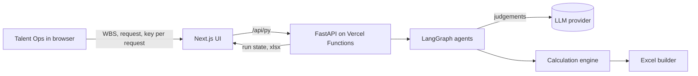
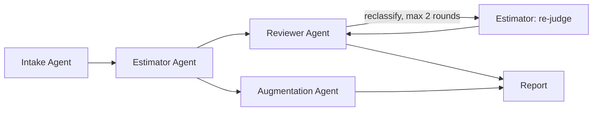

# AIX Talent Planning

AIX extends [Talent Estimation Agent](https://github.com/adryanra97/talent-estimation-agent)
with project capability mapping, cross-role talent recommendations, capacity
planning, and human-selected assignments. The upstream MIT license and author
attribution are retained.

Open **Pemetaan & Penugasan** to continue from an estimation run or import an
existing validation workbook. Upload your talent skill inventory, enter current
FTE, review skill targets, and choose the people and allocations yourself.
All talents are scored for each project role regardless of their primary or
preferred role. The transparent score combines skill proficiency (70%), target
coverage (20%), and capacity (10%).

See [the workflow and scoring guide](docs/talent-assignment.md). The public app
does not ship with personal talent data. Upload your workbook for each session
or restore a session file you saved locally. The default catalog includes 127
data-role skills with English definitions.

The original estimation features are documented below.

[](https://github.com/adryanra97/talent-estimation-agent/actions/workflows/ci.yml)

[](https://docs.astral.sh/ruff/)
[](https://docs.astral.sh/uv/)

[](LICENSE)

An agentic system that validates talent requests for a project. It reads the
work breakdown structure (WBS) and the request document, decides which roles
every work package needs, and estimates the full-time equivalent (FTE) per
role with two independent methods: Use Case Points (UCP) and bottom-up
estimation. An optional agent maps which parts of the work can be accelerated
with AI assistance, per capability.

Language models judge and explain. Deterministic code calculates. Nothing is
stored on the server.

## What it does

- Reads a WBS workbook in any reasonable layout and keeps only leaf work packages.
- Reads the requested FTE per role from a PDF, Word, or text request.
- Decides, per item and role, whether the role is primary or supporting, the
  UCP class, and the FTE allocation, each with a written reason.
- Calculates UCP effort, bottom-up effort, average and peak FTE per month.
- Compares the additional need (total minus existing talent) with the request.
- Reviews its own output: rows where both methods disagree are sent back for
  another judgement, up to two rounds. Gaps, overlaps, and work found only in
  meeting notes become findings.
- Shows an AI assistance scenario per task and capability, without changing
  the baseline numbers.
- Exports the full validation workbook with live formulas, so a reviewer can
  change one input and see every total update.

## Architecture





| Agent | Skills | Kind |
|---|---|---|
| Orchestrator | scope, ordering, retries, review rounds, trace | code |
| Intake Agent | `parse_wbs`, `parse_request`, `map_capability` | code, LLM, code |
| Estimator Agent | `classify_item`, `assess_factors`, `ucp_calc`, `bu_calc` | LLM, LLM, code, code |
| Reviewer Agent | `reconcile`, `check_quality` | code, LLM |
| Augmentation Agent (optional) | `assess_ai_assist`, `calc_ai_savings` | LLM, code |
| Report | `draft_message`, `fill_excel` | LLM, code |

Every LLM skill has a rule-based fallback. It powers the demo mode, the tests,
and serves as a baseline in evaluation.

## Stack

| Part | Technology |
|---|---|
| Agents | Python 3.12, LangGraph, LangChain chat models |
| Contracts | Pydantic v2, structured output with schema validation |
| API | FastAPI on Vercel Python Functions (stateless) |
| Excel | openpyxl, formulas recalculated by Excel on open |
| UI | Next.js, React, Tailwind CSS, Recharts |
| Evaluation | Kedro pipeline (offline) |
| Tooling | uv, ruff, mypy, pytest, pre-commit, GitHub Actions |

Supported model providers: Google Gemini, Anthropic Claude, OpenAI, Azure
OpenAI, and any OpenAI-compatible endpoint.

## Quick start

Requirements: [uv](https://docs.astral.sh/uv/) and Node.js 22.

```bash
uv sync --all-packages --extra dev   # Python environment from uv.lock
npm install
npm run dev                          # Next.js on :3000 and the API on :8000
```

Open http://localhost:3000 and choose **Coba mode demo** to run the agents on
a fictional project without an API key. To use a model, open **Pengaturan**,
choose a provider, and paste a key. The key stays in browser memory.

Checks:

```bash
uv run ruff check src api tests
uv run mypy
uv run pytest --cov=talent_estimation
cd evaluation && uv run kedro run
```

## Quality checks

Every push and pull request runs the checks below in GitHub Actions. All
checks run to the end even when one fails, and the run page shows a summary
table with the result and duration of each check plus its full log. Test and
coverage reports are attached to the run as artifacts.

| Check | Tool | What it verifies |
|---|---|---|
| Lint | Ruff | Code style, imports, bug patterns, NumPy-style docstrings |
| Format | Ruff formatter | Consistent formatting (`ruff format --check`) |
| Types | mypy with the Pydantic plugin | Type correctness of the package |
| Tests | pytest with pytest-cov | Unit, integration, and API tests with line coverage |
| Excel formulas | LibreOffice | The downloaded workbook recalculates to the same numbers as the engine |
| Evaluation | Kedro | The evaluation and calibration pipeline runs on the sample case |
| Dependencies | uv | `requirements.txt` for Vercel matches `uv.lock` |
| Web types | TypeScript | `tsc --noEmit` on the interface |
| Web build | Next.js | Production build succeeds |

Locally, `pre-commit install` runs Ruff and keeps `requirements.txt` in sync
before every commit.

## Deploy

Import the repository in Vercel. No environment variables are needed. The UI
is built by Next.js and `api/index.py` runs as a Python function. See
[docs/04-implementation/deployment.md](docs/04-implementation/deployment.md).

## Repository layout

```
api/                 FastAPI entrypoint (Vercel function)
app/, components/,   Next.js user interface
lib/
src/talent_estimation/
  agents/            LangGraph graph and pipeline
  skills/            LLM skills, prompts, schemas, agent cards
  calc/              Calculation engine (single source of truth)
  catalog/           Capability catalog and loader
  excel/             Workbook builder
  io/                WBS reader and document text extraction
  llm/               Provider-agnostic client and PII masking
  demo/              Fictional sample project
evaluation/          Kedro project for evaluation and PHM calibration
docs/                Analysis and design documentation
tests/
```

## Documentation

The documentation follows the phases of the Unified Process as described in
Dennis, Wixom, and Tegarden, *Systems Analysis and Design: An Object-Oriented
Approach with UML*: planning, analysis, design, and implementation. Start at
[docs/README.md](docs/README.md).

## Privacy

- The server has no database and writes no files. Every request stands alone.
- Uploaded files are parsed in memory. Only the text needed for a judgement is
  sent to the model; e-mail addresses, phone numbers, and 16-digit ID numbers
  are masked by default.
- The run result lives in the browser tab. Closing the tab discards it.
- The repository contains no real project data. The demo project is fictional.

## Author

Adryan Rizky Alviano. Released under the [MIT License](LICENSE).
